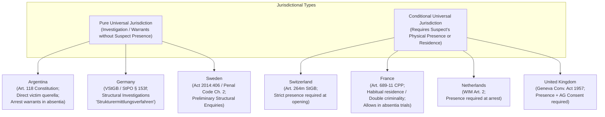
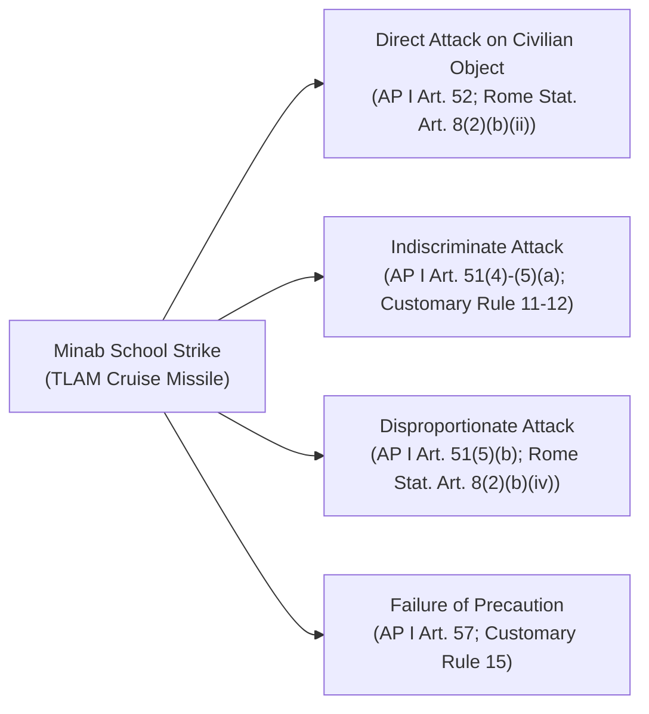
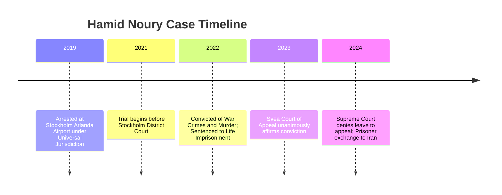
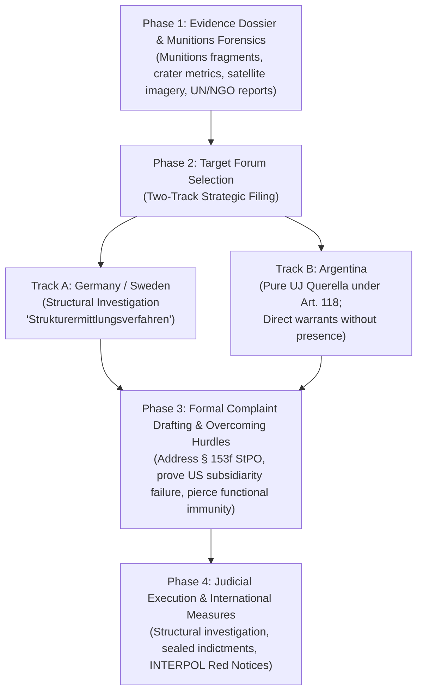

# Universal Jurisdiction for War Crimes: Global Domestic Law Survey, Case Law Precedents, and Strategic Analysis for the Minab Strike

---

## Executive Summary

**Universal Jurisdiction (UJ)** is the legal principle allowing national judicial authorities to investigate and prosecute individuals suspected of core international crimes—specifically **war crimes**, **crimes against humanity**, **genocide**, and **torture**—regardless of where the crime was committed, the nationality of the perpetrator, or the nationality of the victims. 

This survey analyzes:
1. **Domestic legal frameworks** across key jurisdictions that permit the initiation of criminal proceedings under universal jurisdiction.
2. **Substantive and procedural applicability** of these domestic laws to the **Minab School Strike** (February 28, 2026; Shajareh Tayyebeh Elementary School, Hormozgan Province, Iran; ~156–175 civilian casualties resulting from a Tomahawk cruise missile strike).
3. **In-depth case briefs** of landmark universal jurisdiction proceedings in domestic courts (addressing facts, statutory bases, current procedural status, judicial outcomes, and lessons for strategic litigation).
4. **An operational roadmap** detailing procedural entry points, overcoming jurisdictional hurdles (e.g., *ratione materiae* immunity, prosecutorial discretion, and subsidiarity), and evidentiary preparation.

---

## 1. Global Survey of Domestic Universal Jurisdiction Frameworks

Under international treaty law—most notably the **Four Geneva Conventions of 1949** (Common Articles 49/50/129/146) and the **1984 UN Convention Against Torture (CAT)** (Articles 5–7)—States Parties have an affirmative legal obligation (*aut dedere aut judicare*) to search for and prosecute or extradite persons alleged to have committed grave breaches. However, the domestic realization of universal jurisdiction varies substantially between jurisdictions:

---

### 1.1 Germany (*Federal Republic of Germany*)
* **Primary Statutes:** 
  * *Völkerstrafgesetzbuch* (VStGB – Code of Crimes against International Law, 2002), Sections 1, 8 (War crimes against persons), 9 (War crimes against property and other rights), 11 (War crimes involving unlawful methods of warfare), 12 (War crimes involving unlawful employment of means of warfare).
  * *Strafprozessordnung* (StPO – Code of Criminal Procedure), Section 153f.
* **Jurisdictional Reach:** 
  * Under **Section 1 VStGB**, German criminal law applies to all criminal offenses against international law designated in the code, **"even when the act was committed abroad and bears no relation to Germany."**
* **Procedural Mechanism:**
  * **Structural Investigations (*Strukturermittlungsverfahren*):** The Federal Public Prosecutor General (*Generalbundesanwalt* – GBA) at the Federal Court of Justice (*Bundesgerichtshof*) can open broad structural investigations without naming a specific suspect to secure evidence, preserve satellite imagery, and record survivor depositions.
  * **Targeted Investigations (*Personenbezogenes Ermittlungsverfahren*):** Opened once specific individual perpetrators within the command structure are identified.
* **Limitations and Discretion:**
  * Under **Section 153f StPO**, the GBA possesses statutory discretion to refrain from prosecuting if:
    1. The suspect is not present in Germany and their arrival is not anticipated;
    2. The crime is being prosecuted by an international court or by the territorial/national state (subsidiarity).
  * *Strategic implication:* Historically invoked to decline complaints against foreign superpowers (e.g., the Donald Rumsfeld cases). To bypass § 153f, complainants must document a total failure or refusal by the perpetrator's home state to genuinely investigate.

---

### 1.2 Sweden (*Kingdom of Sweden*)
* **Primary Statutes:**
  * Act on Criminal Responsibility for Genocide, Crimes against Humanity and War Crimes (*Lag om straffansvar för folkmord, brott mot mänskligheten och krigsförbrytelser*, Swedish Code of Statutes SFS 2014:406).
  * Swedish Penal Code (*Brottsbalken*), Chapter 2, Section 3(6).
* **Jurisdictional Reach:**
  * Swedish courts possess universal jurisdiction over war crimes, genocide, and crimes against humanity regardless of the perpetrator's nationality or the locus of the crime.
* **Specialized Infrastructure:**
  * The **National Public Prosecution Department** maintains a dedicated unit: the *Riksenheten mot internationell och organiserad brottslighet* (RIO), working with the War Crimes Commission (*Krigsbrottskommissionen*) of the Swedish Police.
* **Procedural Mechanism:**
  * Preliminary investigations can be initiated without the suspect's presence. However, an indictment (*åtal*) and trial require the suspect’s physical presence in Sweden or custody, alongside prosecutorial screening (*åtalsförordnande*).
  * Sweden demonstrated its willingness to adjudicate state-linked crimes from Iran in the historic **Hamid Noury** trial.

---

### 1.3 Switzerland (*Swiss Confederation*)
* **Primary Statutes:**
  * Swiss Criminal Code (*Schweizerisches Strafgesetzbuch* – StGB / Code pénal suisse – CP), Articles 264–264m (inserted in 2011).
  * Swiss Military Criminal Code (*Militärstrafgesetz* – MStG).
* **Jurisdictional Reach:**
  * Articles 264b–264j CP specifically criminalize war crimes in international and non-international armed conflicts.
* **Presence Requirement (Article 264m CP):**
  * Switzerland operates under **conditional universal jurisdiction**. Under Article 264m CP, Swiss federal authorities can only open formal criminal proceedings if the suspect is **physically present on Swiss territory** at the time the complaint is processed, and Switzerland does not extradite the individual to another competent court.
* **Prosecutorial Authority:**
  * The Office of the Attorney General of Switzerland (*Bundesanwaltschaft* – OAG / *Ministère public de la Confédération*) has an active specialized International Criminal Law unit.

---

### 1.4 France (*French Republic*)
* **Primary Statutes:**
  * French Code of Criminal Procedure (*Code de procédure pénale* – CPP), Articles 689-1 and 689-11.
  * French Criminal Code (*Code pénal*), Articles 461-1 through 461-31.
* **Jurisdictional Conditions & The "Four Locks":**
  * Historically, Article 689-11 CPP imposed four restrictive prerequisites:
    1. *Habitual Residence (*résidence habituelle*):* The suspect must habitually reside in France.
    2. *Double Criminality (*double incrimination*):* The foreign state where acts occurred must criminalize the conduct.
    3. *Prosecutorial Monopoly:* Only the National Anti-Terrorism Prosecutor’s Office (*Parquet National Antiterroriste* – PNAT) can initiate public prosecution (civil parties cannot directly compel an investigating magistrate via *constitution de partie civile* under Art. 689-11).
    4. *Subsidiarity:* The PNAT must verify that no international court or national court asserts jurisdiction.
* **May 12, 2023 Judicial Breakthrough:**
  * The French Court of Cassation (*Cour de cassation*, Plenary Assembly) ruled that "double criminality" does not require identical statutory formulations; underlying acts (e.g., murder, assault) criminalized under local law suffice.
* **Trials In Absentia (*Procédure par défaut*):**
  * Uniquely, French law permits the *Cour d'Assises* to conduct trials and issue convictions *in absentia* when suspects cannot be arrested, as illustrated in the 2024 Dabbagh case against senior Syrian intelligence chiefs.

---

### 1.5 Argentina (*Argentine Republic*)
* **Primary Statutes:**
  * **Article 118 of the Argentine National Constitution:** Explicitly authorizes federal courts to try crimes committed against the "law of nations" (*derecho de gentes*) outside the territory of the Republic.
  * Law 26.200 (2006) implementing the Rome Statute.
* **Jurisdictional Reach:**
  * Argentina is globally recognized for exercising **pure universal jurisdiction**.
  * Victims and non-governmental organizations have the direct procedural right to initiate a private criminal complaint (*querella*) directly before a Federal Judge (*Juez Federal*).
* **Key Strategic Feature:**
  * Argentine federal judges do not require the physical presence of the accused to initiate a formal judicial inquiry, take depositions from victims worldwide, issue indictments, and publish **international arrest warrants via INTERPOL Red Notices** (e.g., the Franco-era Spain case and the Rohingya Genocide case against Myanmar's military leadership).

---

### 1.6 The Netherlands (*Kingdom of the Netherlands*)
* **Primary Statutes:**
  * International Crimes Act (*Wet internationale misdrijven* – WIM) of June 19, 2003.
* **Jurisdictional Reach:**
  * Section 2(1)(a) WIM grants Dutch courts jurisdiction over anyone who commits an international crime abroad if the suspect is **present on the territory of the Netherlands**.
* **Procedural Mechanism:**
  * The National Public Prosecutor's Office (*Landelijk Parket*) houses the International Crimes Team (*Team Internationale Misdrijven* – TIM). Dutch authorities monitor entry manifests and conduct preliminary investigations, arresting targets immediately upon entry.

---

### 1.7 United Kingdom (*England and Wales, Scotland, Northern Ireland*)
* **Primary Statutes:**
  * **Geneva Conventions Act 1957** (as amended by the Geneva Conventions (Amendment) Act 1995), Section 1.
  * **International Criminal Court Act 2001**, Sections 51, 68.
* **Jurisdictional Reach:**
  * Section 1 of the Geneva Conventions Act confers universal jurisdiction over "grave breaches" of the 1949 Geneva Conventions and Additional Protocol I, regardless of nationality or location.
* **Limitations:**
  * Under Section 1A of the Geneva Conventions Act and Section 53 of the ICC Act, prosecutions require the **mandatory written consent of the Attorney General**.
  * Arrest and trial require the suspect’s physical presence within the UK jurisdiction.

---

## 2. In-Depth Legal Assessment: The Minab War Crime

### 2.1 Factual Matrix
* **Date & Time:** February 28, 2026, during morning school hours.
* **Target:** Shajareh Tayyebeh Elementary School, Minab, Hormozgan Province, Islamic Republic of Iran.
* **Ordnance & Delivery:** Precision-guided Tomahawk Land Attack Missiles (TLAM) launched during opening strikes by foreign forces (US / Coalition assets).
* **Casualties:** 156 to over 175 confirmed dead—overwhelmingly young female elementary students, teachers, and parents—alongside dozens of severely wounded.
* **Surrounding Topography & Intelligence Context:** The primary school was an active civilian educational facility with a distinct street entrance, structurally walled off from an adjacent naval logistics facility of the Islamic Revolutionary Guard Corps (IRGC). Independent investigations by UN Special Procedures, Human Rights Watch, and Amnesty International established that the strike weapon debris, flight trajectories, and post-blast cratering matched US-manufactured precision munitions, pointing to target intelligence failure (reliance on outdated target sets without real-time ISR verification).

---

### 2.2 Substantive Criminal Classifications under International Humanitarian Law (IHL)

1. **Direct Attack on a Protected Civilian Object / School:**
   * *Normative Basis:* Article 52 of Additional Protocol I (AP I) to the 1949 Geneva Conventions; Rule 7 of Customary IHL; Article 8(2)(b)(ii) and (ix) of the Rome Statute; Section 9(1) of the German VStGB.
   * *Analysis:* Educational institutions enjoy prima facie protection as civilian objects. Unless used simultaneously to make an effective contribution to military action, attacking a primary school constitutes a grave breach of the Geneva Conventions.
2. **Indiscriminate Attack:**
   * *Normative Basis:* Article 51(4) and 51(5)(a) AP I; Customary IHL Rule 11.
   * *Analysis:* Launching ordnance into an area containing a known civilian school during school hours, or treating an entire area containing both military targets and civilian infrastructure as a single target, constitutes an unlawful indiscriminate attack.
3. **Disproportionate Attack:**
   * *Normative Basis:* Article 51(5)(b) AP I; Article 8(2)(b)(iv) Rome Statute; Section 11(1)(3) German VStGB.
   * *Analysis:* Launching an attack with the knowledge that it will cause incidental loss of civilian life clearly excessive in relation to the concrete and direct overall military advantage anticipated.
4. **Failure to Take Feasible Precautions in Attack:**
   * *Normative Basis:* Article 57 AP I; Customary IHL Rule 15.
   * *Analysis:* Planners are legally mandated to verify that targets are military objectives, select weapons and tactics minimizing civilian harm, and suspend/cancel attacks if it becomes apparent the target is civilian or casualties are disproportionate.

---

### 2.3 Individual Criminal Responsibility & Command Structure
Under international criminal law (Rome Statute Articles 25 and 28; AP I Articles 86 and 87), liability extends along two axes:
1. **Direct Liability (Planners and Executors):** Targeting intelligence officers, fire-direction controllers, and operational commanders who finalized the target coordinate packages and cleared the strike without positive identification or morning school-hour mitigation.
2. **Superior / Command Responsibility:** Theater combatant commanders (e.g., US CENTCOM Commander, Joint Forces Air/Maritime Component Commanders) who knew or had reason to know that the attack involved severe risks to civilian school facilities and failed to take necessary and reasonable measures to prevent the strike or investigate and submit the matter to competent authorities for prosecution.

---

### 2.4 Navigating Legal Defenses and Obstacles

#### 1. Official Immunity (*Ratione Personae* vs. *Ratione Materiae*)
* **Head of State / Personal Immunity (*Ratione Personae*):** Absolute immunity before foreign domestic courts belongs exclusively to sitting Heads of State, Heads of Government, and Ministers of Foreign Affairs (ICJ *Arrest Warrant of 11 April 2000*, DRC v. Belgium). Therefore, a sitting US President or Secretary of State cannot be prosecuted in a foreign domestic court while in office.
* **Functional Immunity (*Ratione Materiae*):** Military commanders, intelligence officials, targeting analysts, and ordnance officers only possess functional immunity for official state acts. **Prevailing customary international law and modern domestic jurisprudence firmly establish that functional immunity does NOT shield individuals from prosecution for war crimes and crimes against humanity.**
  * *German Federal Court of Justice Precedent (BGH, Decision of 28 January 2021 – 3 StR 564/19):* The BGH explicitly affirmed that foreign military officers and state agents cannot invoke functional immunity (*ratione materiae*) before German domestic criminal courts for international crimes.

#### 2. The Subsidiarity Barrier & Prosecutorial Discretion (The "Rumsfeld Hurdle")
* When complaints involve armed forces of world powers, domestic prosecutors frequently invoke subsidiarity to decline jurisdiction (as seen in Germany under § 153f StPO).
* *Counter-Strategy:* The legal brief accompanying any domestic filing must present indisputable evidentiary proof that the US Department of Defense, CENTCOM, and the US Department of Justice have closed internal inquiries without initiating genuine, independent criminal court-martial proceedings against the chain of command, satisfying the standard of state unwillingness or inability under international law.

---

## 3. Landmark Universal Jurisdiction Cases in Domestic Courts

The following eight case studies represent foundational domestic universal jurisdiction proceedings, detailing facts, statutory applications, current status, outcomes, and strategic lessons directly relevant to the Minab litigation.

---

### Case 1: *Hamid Noury* (Stockholm District Court & Svea Court of Appeal, Sweden)

#### Factual Context & Indictment
Hamid Noury, an Iranian national and former assistant to the deputy prosecutor at Gohardasht (Rajai Shahr) Prison in Karaj, Iran, was arrested on November 9, 2019, upon arriving at Stockholm Arlanda Airport. The prosecution charged Noury with **grave breaches of international humanitarian law (war crimes)** and **murder** relating to his role in the **1988 mass executions of political prisoners** in Iran.

Following a fatwa issued by Ayatollah Khomeini towards the end of the Iran-Iraq War—specifically targeting members of the People's Mojahedin Organization of Iran (PMOI/MEK) and leftist/communist prisoners—thousands of political detainees were summarily executed without fair trials. Noury was identified by survivors as actively participating in the "death commissions," organizing prisoner line-ups, escorting prisoners to the execution room ("amphitheater"), and reading out execution lists.

#### Legal Basis & Domestic Jurisdiction Applied
The Swedish Prosecution Authority (*Åklagarmyndigheten*) grounded jurisdiction in:
* **Chapter 2, Section 3(6) of the Swedish Penal Code (*Brottsbalken*)**, which confers universal jurisdiction over serious crimes committed abroad;
* **Chapter 22, Section 6 of the Penal Code** (applicable at the time of the 1988 offenses), incorporating grave violations of international humanitarian law (war crimes).

The Swedish court characterized the armed conflict between Iran and the PMOI (operating from Iraqi territory during the Iran-Iraq War) as an **international armed conflict (IAC)** due to Iraq's logistical and military backing of the PMOI, allowing the direct application of Common Article 2 of the Geneva Conventions and customary war crimes provisions.

#### Judicial Proceedings & Final Result
* **Trial Court (Stockholm District Court):** The trial spanned 93 trial days from August 2021 to May 2022. On **July 14, 2022**, the District Court found Noury guilty of war crimes and murder, sentencing him to **life imprisonment** and ordering permanent expulsion from Sweden alongside financial reparations to victims' families.
* **Appellate Review (Svea Court of Appeal):** On **December 19, 2023**, the Svea Court of Appeal (*Svea hovrätt*) unanimously upheld the conviction and life sentence in full.
* **Supreme Court:** On **March 6, 2024**, the Supreme Court of Sweden (*Högsta domstolen*) denied Noury leave to appeal, rendering the verdict final and non-appealable under Swedish law.
* **Subsequent Development:** On **June 15, 2024**, the Swedish government pardoned and released Noury in a bilateral prisoner exchange for two Swedish nationals held in Iran.

#### Strategic Relevance & Lessons
1. Demonstrates that domestic courts can successfully establish universal jurisdiction over foreign state officials for atrocities occurring decades prior in non-European states.
2. Confirmed that an individual need not be the ultimate architect; functional administrative facilitators and assistants in the execution chain are fully culpable as co-perpetrators.
3. Official Reference: [TRIAL International Hamid Noury Profile](https://trialinternational.org/latest-post/hamid-noury/) | [Stockholm District Court Judgment Overview](https://www.domstol.se/stockholms-tingsratt/).

---

### Case 2: *Anwar Raslan and Eyad al-Gharib* (Higher Regional Court of Koblenz, Germany)

#### Factual Context & Indictment
Known globally as the **Al-Khatib Trial**, this proceeding represented the world's first criminal trial prosecuting state-sponsored torture by officials of the Syrian government under Syrian President Bashar al-Assad. 

* **Anwar Raslan:** Former Senior Colonel in the Syrian General Intelligence Directorate (*Idarat al-Mukhabarat al-Amma*), who headed the Investigation Unit at **Branch 251 (Al-Khatib Branch)** in Damascus from April 2011 to September 2012. He was indicted for co-perpetrating the torture of at least 4,000 detainees, 58 counts of murder, rape, and severe sexual assault.
* **Eyad al-Gharib:** A lower-ranking intelligence officer accused of aiding and abetting crimes against humanity by arresting and delivering at least 30 protesting civilians to Branch 251 in late 2011, fully aware of the systematic torture practiced there.

#### Legal Basis & Domestic Jurisdiction Applied
* **German Code of Crimes against International Law (*Völkerstrafgesetzbuch* – VStGB):**
  * Section 7(1) VStGB: **Crimes against humanity** (murder, torture, deprivation of physical liberty, sexual violence).
* Under Section 1 VStGB, German federal courts exercised pure universal jurisdiction without requiring German nationality of the perpetrators or victims. Both suspects entered Germany as asylum seekers, where they were identified by survivors and victims represented by the European Center for Constitutional and Human Rights (ECCHR).

#### Judicial Proceedings & Final Result
* **Eyad al-Gharib Judgment:** On **February 24, 2021**, the Higher Regional Court of Koblenz (*Oberlandesgericht Koblenz* – OLG Koblenz) convicted al-Gharib of aiding and abetting crimes against humanity, sentencing him to **4 years and 6 months of imprisonment**. The German Federal Court of Justice (*Bundesgerichtshof*) affirmed the verdict on appeal.
* **Anwar Raslan Judgment:** On **January 13, 2022**, the Koblenz court convicted Anwar Raslan of **crimes against humanity**, finding him criminally responsible as a co-perpetrator for the systematic torture of over 4,000 people, 27 counts of murder, and multiple acts of sexual assault. He was sentenced to **life imprisonment**. The court rejected the defense of superior orders (*Handeln auf Befehl*).

#### Strategic Relevance & Lessons
1. Established that state-sponsored systematic torture constitutes a widespread and systematic attack against a civilian population, fulfilling the criteria for crimes against humanity.
2. Affirmed that mid-to-high level supervisory commanders who manage facilities where violations occur bear direct co-perpetration liability, even if they did not personally administer physical abuse.
3. Official Reference: [ECCHR Al-Khatib Trial Dossier](https://www.ecchr.eu/en/case/al-khatib-trial-syria/) | [TRIAL International Anwar Raslan Profile](https://trialinternational.org/latest-post/anwar-raslan/).

---

### Case 3: *Donald Rumsfeld and Others* (Federal Public Prosecutor General, Germany)

#### Factual Context & Criminal Complaints
Following the release of photographic evidence and official reports documenting severe prisoner abuse, torture, and degradation at **Abu Ghraib prison in Iraq** and **Guantánamo Bay**, human rights organizations initiated strategic universal jurisdiction litigation in Germany:
* **The 2004 Complaint:** On November 30, 2004, the New York-based Center for Constitutional Rights (CCR) and German attorneys filed a criminal complaint with the German Federal Public Prosecutor General (*Generalbundesanwalt* – GBA) against US Secretary of Defense **Donald Rumsfeld**, CIA Director George Tenet, Undersecretary of Defense Stephen Cambone, Lieutenant General Ricardo Sanchez, and other military planners.
* **The 2006 Complaint:** Following renewed evidence of torture memos, the European Center for Constitutional and Human Rights (ECCHR), CCR, and FIDH submitted an expanded 220-page complaint in November 2006, targeting Rumsfeld, former Attorney General Alberto Gonzales, and senior Department of Defense legal counsel.

#### Legal Basis & Statutory Arguments
The complaints invoked:
* **Sections 8(1) and 8(3) VStGB:** War crimes against persons (torture, cruel and inhuman treatment, willful killing).
* **Section 13 VStGB:** Command responsibility of superiors for failure to prevent or repress war crimes committed by subordinates.
* Complainants argued that because the United States explicitly granted immunity to civilian architects under the Military Commissions Act and refused to appoint an independent special prosecutor, Germany’s universal jurisdiction was triggered.

#### Judicial Outcome & Dismissal Rationale
In both instances, the Federal Prosecutor General **refused to initiate a formal criminal investigation**:
* **The GBA's Decision:** The GBA exercised prosecutorial discretion under **Section 153f of the German Code of Criminal Procedure (StPO)**.
* **The Legal Rationale:** The Prosecutor asserted the **principle of subsidiarity**. The GBA determined that because the alleged perpetrators were US citizens and the acts were committed outside Germany, the primary jurisdiction rested with the United States. The GBA pointed to US Congressional hearings and low-level military courts-martial of enlisted soldiers as evidence that the domestic US legal system was addressing the abuses, despite the clear absence of investigations into cabinet-level architects.

#### Strategic Relevance & Lessons for the Minab Case
1. **The Primary Precedent for Claims Against US Officials:** Proves that filing an adversarial complaint against high-level US defense leadership before European prosecutors will trigger immediate political and procedural resistance under discretionary provisions like § 153f StPO.
2. **Evidentiary Requirement to Overcome Subsidiarity:** Complainants targeting the Minab strike must legally dissect the US military justice system upfront, proving that the US Air Force / CENTCOM Article 15-6 administrative reviews or collateral damage assessments are non-punitive, legally defective, and constitute institutional bad faith, leaving foreign universal jurisdiction as the sole avenue for justice.
3. Official Reference: [ECCHR Rumsfeld Case Summary](https://www.ecchr.eu/en/case/donald-rumsfeld-and-others/) | [CCR Rumsfeld War Crimes Case Overview](https://ccrjustice.org/home/what-we-do/our-cases/rumsfeld-war-crimes-case-germany).

---

### Case 4: *The Rohingya Genocide Investigation* (Federal Criminal Court, Argentina)

#### Factual Context & Private Criminal Complaint
In August 2017, the Myanmar armed forces (*Tatmadaw*) launched violent "clearance operations" across Rakhine State against the ethnic Muslim **Rohingya minority**. The operations involved mass extrajudicial executions, widespread sexual violence, and the systematic burning of hundreds of villages, driving over 750,000 Rohingya into Bangladesh.

On November 13, 2019, the **Burmese Rohingya Organisation UK (BROUK)**, represented by Argentine human rights lawyers and supported by Latin American legal organizations, filed a private criminal complaint (*denuncia*) before the Federal Criminal Court in Buenos Aires under universal jurisdiction. The complaint alleged **genocide** and **crimes against humanity** committed by Myanmar’s military leadership, including Senior General **Min Aung Hlaing**.

#### Legal Basis & Pure Universal Jurisdiction Mechanism
* **Article 118 of the Constitution of the Argentine Republic:** Grants federal tribunals jurisdiction to try offenses against public international law committed abroad.
* **Subsidiarity Overruled:** A lower federal judge initially rejected the complaint in 2021, arguing that the International Criminal Court (ICC) was already investigating the situation. However, on **November 28, 2021**, the **Federal Criminal Court of Appeals (*Cámara Federal de Casación Penal*)** reversed the dismissal. The Appeals Court ruled that because the ICC’s jurisdiction was legally limited to crimes that partially occurred in Bangladesh (an ICC member state) and did not cover the direct genocidal acts inside Myanmar, Argentine universal jurisdiction was fully applicable.

#### Current Procedural Status & Historic Result
* **Active Federal Investigation:** Federal Judge María Romilda Servini and Federal Prosecutor Carlos Stornelli formally opened judicial proceedings, receiving live video testimony from Rohingya survivors and obtaining official evidence from the UN Independent Investigative Mechanism for Myanmar (IIMM).
* **Issuance of International Arrest Warrants:** In late 2023, the Argentine Federal Court took the unprecedented step of formally **issuing international arrest warrants** for 25 high-ranking Myanmar military and civilian officials, including Senior General Min Aung Hlaing.
* **Expansion to Asset Reparations:** In 2024, the court authorized investigative measures into economic assets and commercial conglomerates owned by the Myanmar military to secure reparations for victims.

#### Strategic Relevance & Lessons
1. Demonstrates that **pure universal jurisdiction** can proceed effectively without the suspects' presence, culminating in international arrest warrants via INTERPOL.
2. Validates direct victim standing: Civil organizations can initiate and steer proceedings without relying on executive prosecutorial discretion.
3. Official Reference: [TRIAL International Rohingya Argentine Investigation](https://trialinternational.org/latest-post/rohingya-genocide/) | [UN Human Rights Documentation](https://www.ohchr.org/en/hr-bodies/hrc).

---

### Case 5: *Alieu Kosiah* (Federal Criminal Court & Federal Supreme Court, Switzerland)

#### Factual Context & Indictment
Alieu Kosiah was a high-ranking military commander of the **United Liberation Movement of Liberia for Democracy (ULIMO)**, an armed faction active during the First Liberian Civil War (1989–1996). 

Kosiah was accused of orchestrating and personally executing atrocities against civilians in Lofa County between 1993 and 1995. The offenses included ordering and committing murders, torture, cruel and inhuman treatment, rape, forced labor under extreme conditions, recruitment of child soldiers, and acts of cannibalism. Following the civil war, Kosiah relocated to Switzerland, where he obtained permanent residency.

#### Legal Basis & Domestic Application
In November 2014, Swiss human rights organization *Civitas Maxima* and Liberian victims filed a criminal complaint with the Swiss Office of the Attorney General (OAG). Kosiah was arrested in Bern on November 10, 2014.
* **Statutory Framework:** Swiss Military Criminal Code (MStG), Articles 108 and 109 (governing war crimes), supplemented by the Swiss Criminal Code (StGB).
* **Jurisdictional Anchor:** Article 264m StGB was satisfied because Kosiah was **physically present on Swiss territory** at the time of arrest and resided in Switzerland.

#### Judicial Proceedings & Final Result
* **First Instance (Federal Criminal Court – *Tribunal pénal fédéral*, Bellinzona):** On **June 18, 2021**, the court found Kosiah guilty of multiple counts of war crimes (murder, cruel treatment, rape, pillage) and sentenced him to **20 years of imprisonment**.
* **Appellate Chamber (*Cour d'appel*):** In a historic judgment on **January 11, 2023**, the Appeals Chamber affirmed the 20-year sentence and expanded the conviction to include **crimes against humanity**—marking the first time crimes against humanity were recognized in a Swiss criminal conviction.
* **Federal Supreme Court Review (*Bundesgericht*):** In early 2024, the Swiss Federal Supreme Court rejected Kosiah’s final appeal, rendering the 20-year sentence final.

#### Strategic Relevance & Lessons
1. Marks the first war crimes conviction under Swiss universal jurisdiction, proving Switzerland’s specialized prosecution capacity.
2. Illustrates the strict necessity of the suspect’s presence: Without physical custody on Swiss soil, Swiss prosecutors cannot maintain formal indictments.
3. Official Reference: [TRIAL International Alieu Kosiah Case](https://trialinternational.org/latest-post/alieu-kosiah/) | [Swiss Federal Criminal Court Judgment Dossier](https://www.bstger.ch/).

---

### Case 6: *Ousman Sonko* (Federal Criminal Court, Switzerland)

#### Factual Context & Indictment
Ousman Sonko served as the **Minister of Interior of The Gambia** from 2006 to 2016 under the authoritarian regime of President Yahya Jammeh, having previously served as Inspector General of Police and Commander of the State Guards.

Sonko fled The Gambia in September 2016, sought asylum in Switzerland, and was arrested in January 2017 in Bern following a criminal complaint submitted by TRIAL International. The indictment charged Sonko with multiple counts of **crimes against humanity**, specifically participation in and institutional authorization of intentional killings, torture, unlawful detention, and serious sexual violence against political opponents, journalists, and peaceful protesters.

#### Legal Basis & Ministerial Responsibility
* **Articles 264a–264j of the Swiss Criminal Code (StGB):** Incorporated in 2011 to establish universal jurisdiction over crimes against humanity.
* **Modes of Liability:** The prosecution charged Sonko not merely as a direct perpetrator of specific assaults, but under doctrines of **co-perpetration, superior order enforcement, and command responsibility by omission**—asserting that as Minister of Interior, he exercised operational command over the Gambian police, the National Intelligence Agency (NIA), and prison authorities.

#### Historic Verdict & Current Status
* **Verdict (May 15, 2024):** The Federal Criminal Court in Bellinzona convicted Ousman Sonko of **crimes against humanity** (including intentional homicide, torture, and severe deprivation of liberty) and sentenced him to **20 years of imprisonment**.
* **Significance:** Sonko became the **highest-ranking state official ever tried and convicted in Europe under universal jurisdiction**.
* **Appeals:** As of late 2024/2026, appellate proceedings before the Swiss Federal Criminal Court's Appeals Chamber remain underway concerning dismissed sexual violence charges, while Sonko remains in detention serving the 20-year sentence.

#### Strategic Relevance & Lessons
1. Proves that cabinet-level government ministers are subject to universal jurisdiction trials in domestic European courts once they lose official *ratione personae* status.
2. Establishes institutional command liability: A civilian or interior minister can be convicted of international crimes for failing to prevent or punish abuses carried out by state security structures under their supervision.
3. Official Reference: [TRIAL International Ousman Sonko Dossier](https://trialinternational.org/latest-post/ousman-sonko/) | [Swiss Federal Criminal Court Official Rulings](https://www.bstger.ch/).

---

### Case 7: *Augusto Pinochet* (House of Lords, United Kingdom & Audiencia Nacional, Spain)

#### Factual Context & International Warrants
General Augusto Pinochet seized power in Chile through a violent military coup on September 11, 1973, leading a military junta that governed until 1990. During this period, thousands of political dissidents were murdered, forcibly disappeared, tortured, and arbitrarily detained.

In 1996, Spanish investigative magistrate **Baltasar Garzón** of the *Audiencia Nacional* initiated universal jurisdiction investigations into crimes against humanity committed in Chile. In October 1998, while Pinochet was in London for medical treatment, Judge Garzón issued an international arrest warrant requesting his extradition to Spain on charges of genocide, terrorism, and torture. Pinochet was arrested by British police on October 16, 1998.

#### Legal Conflict: Official Immunity vs. Jus Cogens Prohibitions
Pinochet asserted absolute sovereign immunity as a former Head of State. The legal issue reached the UK House of Lords:
* **The Appellate Decision (*Pinochet III* – March 24, 1999, [1999] UKHL 17):** A panel of seven Law Lords ruled by a 6–1 majority that **a former Head of State does not enjoy immunity (*ratione materiae*) for acts of torture**.
* **Core Legal Principle:** The House of Lords held that the international prohibition against torture had attained the status of *jus cogens* (peremptory international law). Because the UN Convention Against Torture (CAT) was ratified by the UK, Spain, and Chile, torturing citizens could not be recognized as an official state function shielded by functional immunity. Extradition was authorized for all acts of torture committed after December 8, 1988 (when the UK incorporated the CAT via Section 134 of the Criminal Justice Act 1988).

#### Final Outcome
Although the British courts upheld the legal validity of universal jurisdiction and rejected functional immunity, British Home Secretary Jack Straw ordered Pinochet’s release in March 2000 on medical grounds (declaring him unfit to stand trial). Pinochet returned to Chile, where the UK precedent prompted Chilean courts to strip his parliamentary immunity; he was subsequently indicted for multiple murders before dying in December 2006.

#### Strategic Relevance & Lessons
1. The foundational precedent establishing that **official state status and functional immunity (*ratione materiae*) evaporate when crimes against humanity or war crimes are alleged**.
2. Established that the implementation of international conventions (e.g., Geneva Conventions, CAT) creates universal jurisdiction obligations that supersede domestic sovereign immunity defenses.
3. Official Reference: [British and Irish Legal Information Institute (BAILII) Judgment [1999] UKHL 17](https://www.bailii.org/uk/cases/UKHL/1999/17.html) | [TRIAL International Pinochet Profile](https://trialinternational.org/latest-post/augusto-pinochet/).

---

### Case 8: *Ali Mamlouk, Jamil Hassan, and Abdel Salam Mahmoud* (Paris Cour d'Assises, France – The Dabbagh Case)

#### Factual Context & Indictment
In November 2013, **Patrick Dabbagh**, a 20-year-old French-Syrian psychology student, was arrested in Damascus by Syrian Air Force Intelligence (*Idarat al-Mukhabarat al-Jawiyya*) and detained at the Mezzeh military airport detention center. His father, **Mazen Dabbagh**, a senior education advisor at the French School of Damascus, was arrested the following day. Both disappeared into the detention system and were subjected to fatal physical and psychological torture. In 2018, the Syrian regime issued official death certificates recording their deaths in detention.

Following complaints filed by the International Federation for Human Rights (FIDH), the Syrian Center for Media and Freedom of Expression (SCM), and the Dabbagh family, French investigating magistrates issued international arrest warrants in 2018 against three top architects of the Syrian security apparatus:
1. **Ali Mamlouk:** Director of the National Security Bureau and special advisor to Bashar al-Assad.
2. **Jamil Hassan:** Director of Syrian Air Force Intelligence.
3. **Abdel Salam Mahmoud:** Head of Investigations at the Air Force Intelligence Mezzeh branch.

#### Legal Basis & Extraterritorial Jurisdiction
The case combined passive personality jurisdiction (due to the victims’ French-Syrian dual nationality) with universal jurisdiction mechanisms governing crimes against humanity and war crimes under the French Code of Criminal Procedure. The investigating magistrates concluded that the Mezzeh detention apparatus was a core component of a widespread and systematic attack against the Syrian civilian population.

#### Historic Verdict In Absentia
* **Trial (*Procédure par défaut*):** Because the Syrian government refused to extradite or acknowledge the warrants, the Paris Criminal Court (*Cour d'Assises de Paris*) held a public four-day trial from **May 21 to May 24, 2024**, *in absentia*.
* **Sentence (May 24, 2024):** The court found all three defendants **guilty of complicity in crimes against humanity and war crimes** (including murder, torture, enforced disappearance, and pillage). Ali Mamlouk, Jamil Hassan, and Abdel Salam Mahmoud were each sentenced to **life imprisonment**. The court ordered that the international arrest warrants remain in full legal force.

#### Strategic Relevance & Lessons
1. Precedent demonstrating that **European domestic courts possess the legal capacity to conduct trials and issue life sentences *in absentia*** against high-ranking military and intelligence commanders who refuse to surrender.
2. Confirms that issuing judicial arrest warrants creates permanent travel bans and risk of arrest across 195 INTERPOL member states.
3. Official Reference: [FIDH Dabbagh Trial Verdict Analysis](https://www.fidh.org/en/region/north-africa-middle-east/syria/france-assad-officials-dabbagh-trial-verdict) | [TRIAL International Syrian State Crimes Monitoring](https://trialinternational.org/).

---

## 4. Comprehensive Synthesis: Comparative Legal Precedents Matrix

| Defendant / Case | Forum State & Court | Underlying Crime & Conflict | Legal Statutory Basis | Primary Legal Challenge | Final Outcome / Current Status |
| :--- | :--- | :--- | :--- | :--- | :--- |
| **Hamid Noury** | Sweden (*Stockholm District Court / Svea Hovrätt*) | 1988 Prison Executions (Iran); War crimes & murder | Penal Code Ch. 2 § 3; Geneva Conventions | Establishing IAC applicability; Extraterritorial evidence | **Guilty**: Life imprisonment (upheld on appeal; prisoner swap June 2024) |
| **Anwar Raslan** | Germany (*OLG Koblenz*) | State torture at Branch 251 (Syria); Crimes against humanity | VStGB §§ 1, 7; StPO universal jurisdiction | Superior orders defense; Command distance from physical torture | **Guilty**: Life imprisonment (Sentence final) |
| **Donald Rumsfeld et al.** | Germany (*Federal Public Prosecutor General*) | Torture at Abu Ghraib & Guantánamo; War crimes | VStGB §§ 1, 8, 13; StPO § 153f | Subsidiarity barrier; Discretionary dismissal | **Dismissed**: GBA declined to open investigation under § 153f StPO |
| **Rohingya Atrocities (Min Aung Hlaing)** | Argentina (*Federal Criminal Court Buenos Aires*) | 2017 Clearance Operations (Myanmar); Genocide & Crimes against humanity | Argentine Constitution Art. 118; Pure Universal Jurisdiction | Overlapping ICC jurisdiction; Remote victim participation | **Active Investigation**: 25 International Arrest Warrants issued; Asset freeze |
| **Alieu Kosiah** | Switzerland (*Federal Criminal Court*) | First Liberian Civil War; War crimes & Crimes against humanity | Swiss Military Criminal Code; Criminal Code Art. 264 | 20-year time lapse; Victim-witness protection and credibility | **Guilty**: 20 years imprisonment (Sentence final) |
| **Ousman Sonko** | Switzerland (*Federal Criminal Court*) | State repression in The Gambia (2000–2016); Crimes against humanity | Swiss Criminal Code Arts. 264a–j; Command responsibility | Proving ministerial operational command over security forces | **Guilty**: 20 years imprisonment (Convicted May 2024; appeals pending) |
| **Augusto Pinochet** | United Kingdom (*House of Lords*) / Spain | State terror in Chile (1973–1990); Torture & Disappearances | Spanish LOPJ Art. 23.4; UK CAT incorporation Act 1988 | Head of State immunity *ratione materiae* | **Immunity Denied**: Extradition authorized; Released on medical grounds |
| **Ali Mamlouk et al.** | France (*Cour d'Assises de Paris*) | Forced disappearance & torture at Mezzeh (Syria) | French Code of Criminal Procedure; Crimes against humanity | Non-appearance of defendants; In absentia legality | **Guilty In Absentia**: Life imprisonment; Permanent arrest warrants |

---

## 5. Strategic Litigation Roadmap for the Minab School Strike

To initiate criminal proceedings under universal jurisdiction for the strike against the Shajareh Tayyebeh Elementary School in Minab, legal teams and civil society organizations should pursue a multi-jurisdictional strategy structured across four operational phases:

### Phase 1: Evidentiary Dossier Assembly
1. **Munitions Debris & Chain of Custody:** Document and catalog physical fragments confirming the use of a Tomahawk Land Attack Missile (TLAM) (e.g., serial markings, turbine engine casings, guidance electronics).
2. **Geospatial & Spatial Verification:** High-resolution commercial satellite imagery demonstrating that the school was an active, walled-off civilian facility with a distinct street entrance, physically separated from the adjacent naval compound.
3. **Casualty Documentation:** Verified civil registries, autopsy records, hospital admissions, and eyewitness depositions confirming the civilian status of the ~156–175 victims and absence of military activity within the school.
4. **Targeting Intelligence Failure Analysis:** Expert military and intelligence assessments proving that striking an educational facility during morning class hours violated target verification mandates under Article 57 AP I.

---

### Phase 2: Forum Selection & Two-Track Strategy

#### Track A: The Structural Investigation Route (*Germany & Sweden*)
* **Forum:** The German Federal Public Prosecutor General (*Generalbundesanwalt* – GBA) in Karlsruhe or the Swedish National Public Prosecution Department (RIO).
* **Objective:** Petition for the immediate opening of a **Structural Investigation (*Strukturermittlungsverfahren*)** on the Minab attack.
* **Legal Advantage:** Does not require the physical presence of US commanders in Germany/Sweden to initiate evidence gathering.
* **Mitigating § 153f StPO:** The complaint must preemptively submit documentation establishing that:
  1. The US military justice system has initiated no court-martial proceedings against operational commanders.
  2. The ICC lacks jurisdiction over US territory and US nationals (as the US is not a party to the Rome Statute, and the crime took place in Iran).

#### Track B: The Direct Judicial Warrant Route (*Argentina*)
* **Forum:** Federal Criminal Court (*Juzgado Criminal y Correccional Federal*) in Buenos Aires, Argentina.
* **Objective:** File a direct private criminal complaint (*querella criminal*) under Article 118 of the Argentine National Constitution on behalf of victims' families and human rights organizations.
* **Legal Advantage:** Pure universal jurisdiction allows Argentine federal judges to initiate a formal judicial investigation, receive international video depositions, and **issue international arrest warrants and INTERPOL Red Notices** against identified military planners and operational commanders without their physical presence in Argentina.

---

### Phase 3: Drafting the Legal Complaint & Defining Liability
* **Charges:** Grave breaches of the Geneva Conventions (willful killing, willfully causing great suffering), unlawful attack against a protected civilian object (Art. 8(2)(b)(ii) Rome Statute), launching an indiscriminate and disproportionate strike (Art. 8(2)(b)(iv) Rome Statute; VStGB § 11).
* **Target Defendants:** Focus on **operational commanders and targeting planners** (e.g., CENTCOM Joint Target Coordination Board members, strike package planners, operational task force leaders) to completely eliminate Head of State immunity defenses (*ratione personae*), while establishing that functional immunity (*ratione materiae*) does not apply to war crimes under the German BGH 2021 precedent and the UK *Pinochet III* rule.

---

### Phase 4: Judicial Execution & Enforcement
* Coordinate with European and international human rights litigators (e.g., ECCHR, TRIAL International, FIDH) to submit joint amicus briefs.
* Request the issuance of **sealed arrest warrants** across European and Latin American jurisdictions to trigger alerts if named operational commanders travel internationally through jurisdictions that enforce bilateral extradition agreements or Rome Statute obligations.

---

## 6. Official Reports and Authoritative Resources

* **TRIAL International Universal Jurisdiction Database:**
  * [TRIAL International Universal Jurisdiction Annual Review (UJAR)](https://trialinternational.org/resources/universal-jurisdiction-annual-review/)
  * [Hamid Noury Case File](https://trialinternational.org/latest-post/hamid-noury/)
  * [Anwar Raslan Case File](https://trialinternational.org/latest-post/anwar-raslan/)
  * [Alieu Kosiah Case File](https://trialinternational.org/latest-post/alieu-kosiah/)
  * [Ousman Sonko Case File](https://trialinternational.org/latest-post/ousman-sonko/)
* **European Center for Constitutional and Human Rights (ECCHR):**
  * [The Al-Khatib Trial (Koblenz) Analysis](https://www.ecchr.eu/en/case/al-khatib-trial-syria/)
  * [Rumsfeld and US War Crimes Universal Jurisdiction Dossier](https://www.ecchr.eu/en/case/donald-rumsfeld-and-others/)
* **Center for Constitutional Rights (CCR):**
  * [Universal Jurisdiction Complaints Against US Officials](https://ccrjustice.org/home/what-we-do/our-cases/rumsfeld-war-crimes-case-germany)
* **Judicial Opinions & United Nations Documents:**
  * [UK House of Lords *Pinochet III* Ruling [1999] UKHL 17 (BAILII)](https://www.bailii.org/uk/cases/UKHL/1999/17.html)
  * [UN Office of the High Commissioner for Human Rights (OHCHR)](https://www.ohchr.org)
  * [FIDH Syrian State Officials Conviction Overview](https://www.fidh.org/en/region/north-africa-middle-east/syria/france-assad-officials-dabbagh-trial-verdict)
